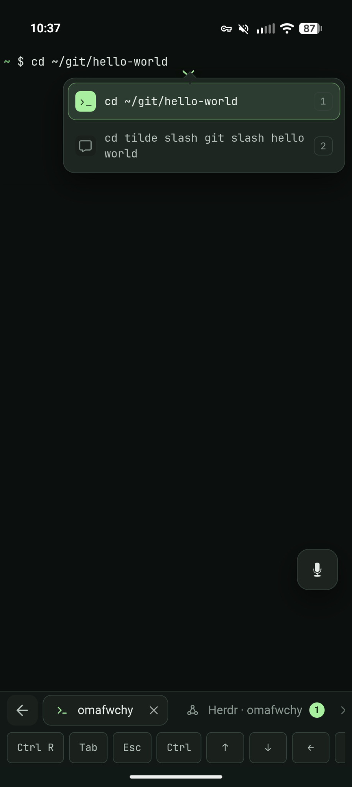
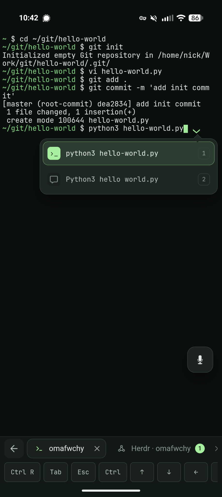
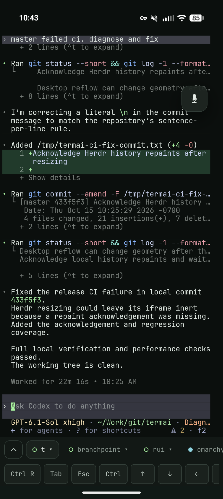

# [libertty](https://libertty.sh)

A webterm designed for modern mobile.

[Website and live demo](https://libertty.sh/) · [Setup guide](https://libertty.sh/setup/) · [Usage guide](https://libertty.sh/usage/)

Run the server on Linux or an Apple Silicon Mac, connect from your phone over Tailscale, and dictate commands.
libertty repairs dictation using your shell’s commands, files and history, with the original text available as an alternative.

<p>
  
  
  
</p>

libertty integrates with [voxtype-mobile](https://github.com/nick1udwig/voxtype-mobile) if you don't have a dictation service.
Dictation runs alongside your server to maximize privacy and minimize latency.

libertty integrates with [herdr](https://github.com/herdrdev/herdr) to provide a first-class agent experience on mobile.
Manage multiple agents via dictation.
Notifications when work is done.
Beautiful and fast.

## Install

Install the server and optionally set up Herdr, Voxtype Mobile and private Tailscale access with:

```sh
curl -fsSL https://install.libertty.sh | bash
```

The installer bundles the native Rust server and its setup runtime, and asks before installing a user service or optional companions.
See the [setup guide](https://libertty.sh/setup/) for supported platforms, upgrade behavior and options.
Linux x86_64, Linux ARM64 and macOS Apple Silicon are release targets, with automatic Voxtype Mobile setup available on Linux.

## Build and run

Building from source requires **Rust 1.89+**, **Node.js 22.18+**, a native C/C++ build toolchain, **Bash 4.4+**, **Python 3.8+**, and `base64`.
On macOS, install modern Bash with `brew install bash`.
The Rust server uses a native PTY and runs the repair engine beside local or SSH host facts.

```sh
npm ci
npm run build
npm start
```

Open **http://127.0.0.1:3000** and enter the **pairing token** printed at startup.
The token is saved and reused after restarts.
Every browser must pair, including on localhost.
Anyone with the token and network access can run commands as your host user.

The shell starts in the checkout directory.
Set `LIBERTTY_CWD=/path/to/project` to change it.
For development, use `npm run dev`.
Vite runs as a loopback frontend tool behind the Rust server's pairing gate, including authenticated hot reload.
Rust is the only backend, while Node supports frontend builds, installation tools and test fixtures.

## Connect from your phone

Sign in to Tailscale on your host and phone using the same tailnet.
Replace the hostname below with your host’s full Tailscale DNS name:

```sh
HOST=127.0.0.1 PORT=7321 LIBERTTY_ALLOWED_HOSTS=my-machine.tail1234.ts.net LIBERTTY_BASE_PATH=/libertty npm start
```

In another terminal:

```sh
tailscale serve --bg --set-path=/libertty http://127.0.0.1:7321
```

Follow any prompt to enable HTTPS, then open **https://my-machine.tail1234.ts.net/libertty** on your phone and pair.
You can add it to your home screen.
Keep libertty running; Tailscale Serve does not start it for you.

## Use it

- **Dictate commands** with your keyboard’s dictation or the built-in Voxtype Mobile integration.
  Review command alternatives before sending.
- **Open hosts** with **+**.
  Connect directly to libertty backends or use SSH through a backend.
  Manage SSH keys in **Vault → Keychain**.
- **View Herdr sessions** with **Connect Herdr** in a host's menu, or by typing `herdr` in a local or SSH terminal.
- **Read files and output** with `look at README.md` or `git diff | look at`.
- **Transfer files** with `upload`, `download foo.py`, or **Connect SFTP / Files** in a host’s menu.
- **Customize** font size, shortcuts and input preferences in **Settings**.
- **Load plugins** in **Settings → Plugins** to add connection actions at runtime.
  Try the included [log viewer package](examples/plugins/example.log-viewer.libertty-plugin.json).

## Documentation

- [Server setup](https://libertty.sh/setup/): one-line installation, companions, Tailscale and user services.
- [Project site](https://libertty.sh/): product features and a working browser demo.
- [Releases](docs/releases.md): native build checks, dependency pins and publishing.
- [Usage guide](https://libertty.sh/usage/): connections, pairing, dictation, touch controls and file transfers.
- [Technical reference](https://libertty.sh/reference/): shell integration, command repair, deployment and testing.
- [Herdr details](https://libertty.sh/herdr/): sessions, mobile sizing and notifications.
- [Site development](docs/site.md): the static site build and browser demo.
- [Runtime plugin experiment](docs/plugins.md): loading packages, plugin API and connection lifetimes.
- [Workspace architecture](docs/workspace.md) and [shared engine](docs/shared-engine.md).
- [Pairing security review](docs/pairing-security.md).

## License

[MIT](LICENSE).
Terminal rendering uses [ghostty-web](https://github.com/coder/ghostty-web) and [Ghostty](https://github.com/ghostty-org/ghostty); the bundled font is [JetBrains Mono](https://github.com/JetBrains/JetBrainsMono).
See [third-party notices](public/THIRD-PARTY-NOTICES.txt) for their licenses.
Keep those notices with redistributed builds.
